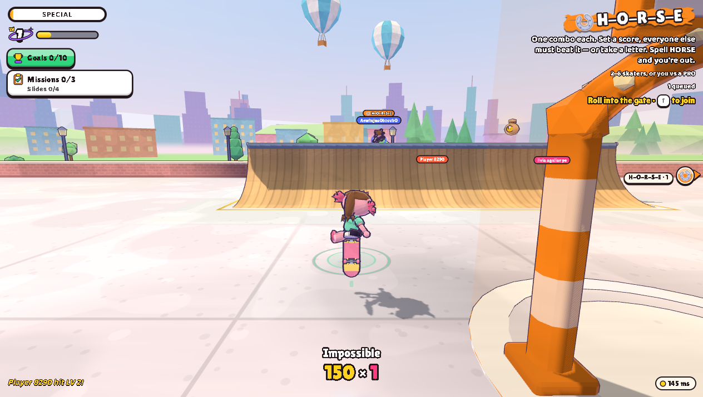

# Tailgrab — offline mirror

Full mirror of **Tailgrab** (https://tailgrab.io/) — "A free multiplayer
skateboarding game in your browser, inspired by Tony Hawk's Pro Skater".

Source: https://tailgrab.io/



## Stack

- **Vite production build, root-served** — a hashed `/assets/*.js` chunk graph
  (56 chunks) behind a modulepreload polyfill; the entry document inlines the
  critical CSS, the splash markup and the gtag bootstrap
- **three.js r186 in the chunk graph** — `assets/three.core-DVWDmH0S.js` (the
  core build) plus the WebGLRenderer bundle the minifier merged into the
  `toon` chunk (the app's toon material/shader code lives at that chunk's
  tail), the GLTFLoader addon (DRACO/KTX2/meshopt) and the OrbitControls addon
- **Colyseus SDK client bundled** — `assets/Client-CpE02kO_.js` is the
  multiplayer client; the game talks to the live backend at
  `backend.tailgrab.io` (`/me`, `/matchmake/joinOrCreate/hub`, websocket) —
  the backend stays external, the mirror is the client
- **A second page for the park viewer** — the origin serves an extensionless
  `/parks` route (`assets/parks-vuvy8Lj9.js` plus its own small chunk graph)
- **Assets are fetched at runtime** — skater kit GLBs (body + board + 31 head
  models), `skaters/clips.json` (2.9 MB of animation clips), 8 park models +
  10 park thumbs, 22 pro portraits, 28 sticker/icon webps, three songs, one
  SFX, `props/props.glb`

## What this is

Tailgrab (tailgrab.io) — a browser skateboarding game in the THPS mould: a
Skate Hub full of riders, mode gates (Trick Attack, Graffiti, H-O-R-S-E,
S-K-A-T-E, Tag, Career), animal pros and secret skaters, a mission/goal
system, and parks you build yourself (the park viewer at `/parks` renders
shared parks). It is a Vite production build: the app code is minified into
hashed chunks, and every skater, park, song and sticker is a runtime fetch
from the asset trees below. The mirror carries the whole runtime closure —
177 files, 30,046,159 bytes (30.0 MB).

External at runtime (documented gaps, never backfilled):

- **the multiplayer backend** — `backend.tailgrab.io` (auth `/me`, Colyseus
  `/matchmake/…` + websocket). The hub seen in the boot/cover screenshots is
  the live multiplayer room: the local client joins it over the network.
  Backend endpoints referenced by the client that 404 to an anonymous GET
  (they need a session or another verb) are recorded in
  `.upstream/capture-log.json`: `/me/*`, `/auth`, `/iap/*`, `/boards/:id`,
  `/replays/:id`, `/parks/daily`, `/parks/:code/doc`.
- **analytics** — `googletagmanager.com` / `google-analytics.com` (the
  inline gtag bootstrap and the external gtag script).
- Two stale dev-branch dynamic imports 404 upstream and are recorded as
  genuine 404s (`/assets/skaterRig.ts`, `/assets/parkModel.ts`).

## Layout

- `index.html` — the entry document as served (byte-exact): external chunk
  refs, an inline critical `<style>`, an inline gtag bootstrap, and an
  `application/ld+json` structured-data block (data, not code)
- `parks/index.html` — the stored `/parks` route page. Layout divergence
  (recorded): the origin serves that HTML at `/parks` (200) and 308-redirects
  `/parks/` → `/parks` while `/parks/index.html` 404s; on disk it is stored as
  `parks/index.html` so a static server reproduces the route through directory
  indexing. `tools/update.mjs` probes it as `/parks`.
- `assets/` — 56 hashed JS chunks + `main-BefG6oT8.css` (byte-exact)
- `skaters/`, `parks/`, `props/`, `music/`, `sfx/`, `stickers/`, `fonts/`,
  `splash/` — the runtime asset trees (byte-exact)
- `readable/` — prettified derived layer (pinned prettier 3.9.6, module API):
  61 pretties — 56 `assets__*.pretty.js`, 2 `*.pretty.css`, and 3 inline
  twins (`index-inline-1.pretty.css`, `index-inline-2.pretty.js`,
  `parks__index-inline-1.pretty.css`) + `readable/index-inline-map.json`
- `src/` — 214 statement-aligned slices `src/<tag>-NN.js` across the 50 app
  chunks, exact 2-line provenance header
- `.upstream/manifest.json` — Gen-A sha256 record for all 177 captured files;
  `.upstream/capture-log.json` — per-file referrer + ref kind, the external
  refs and every genuine 404 (plus tagged heuristic probe misses)
- `split-spec.json` — the derivation record (273 sections, sources, inline
  map, notRendered)
- `tools/fetch-capture.mjs` — re-fetch the runtime closure to fixpoint
  (scan HTML/JS/CSS refs + Vite dep tables + data-table-driven dynamic trees)
- `tools/derive.mjs` — rebuild `readable/` + `src/` + `split-spec.json`
- `tools/verify.mjs` — re-hash the capture against the manifest
- `tools/update.mjs` — read-only drift probe against the live origin
- `tools/audit.js` — integrity gate for the derived layers (`AUDIT PASS`)
- `docs/cover.png` — actual gameplay (skater mid-Impossible in the Skate Hub);
  `docs/boot-2026-10-13.png` — boot evidence (hub rendered, tutorial step 1)

## Assets

- **models — skater kit** — 33 file(s): `skaters/kit/` (`body.glb`,
  `board.glb`, `head-<species>.glb` × 31: hawk, duck, axolotl, muskrat, fox,
  wolf, koala, pony, camel, otter, glider, cat, seal, goat, toad, puffin,
  bear, giraffe, hare, shrew, goose, collie, sagui, tamarin, alien, yeti,
  spider, bat, hyena, chupa, ranger)
- **models — parks** — 8 file(s): `parks/*.glb` (plaza, warehouse, schoolyard,
  pier, mall, hangar, beach, bridge)
- **models — props** — 1 file: `props/props.glb` (lamps, benches, pickups)
- **animation data** — 2 file(s): `skaters/kit/kit.json` (kit + 31 head
  definitions), `skaters/clips.json` (2.9 MB of animation clips)
- **images — portraits** — 22 file(s): `skaters/portraits/*.png` (pro roster)
- **images — park thumbs** — 10 file(s): `parks/thumbs/*.webp`
- **images — branding/splash** — 6 file(s): `logo.webp`, `og.jpg`,
  `favicon.png`, `apple-touch-icon.png`, `splash/wide.webp`, `splash/tall.webp`
- **UI — stickers/icons** — 28 file(s): `stickers/*.webp` (pack stickers,
  quick-chat emotes, coin/star/trophy UI glyphs)
- **audio — music** — 3 file(s): `music/*.mp3` (Recomeçar, Sobre Você,
  Reencontrar)
- **audio — sfx** — 1 file: `sfx/six-seven.mp3`
- **fonts** — 4 file(s): `fonts/` (baloo2.woff2, lilita-one.woff2,
  sedgwick-ave-display.woff2, fonts.css)

## Run

Serve the repo root with any static file server (the capture is a static site;
no build step):

```
npx serve .
```

The game boots to the Skate Hub. It joins the live multiplayer backend
(`backend.tailgrab.io`) over the network — the client code is all local, the
backend stays external; with no backend reachable, network features (hub
roster, matchmaking) fail while the client still runs.

## Verify

```
node tools/verify.mjs     # re-hash the capture against the manifest
node tools/audit.js       # derived-layer integrity gate
```

Last run: `177 files checked, 0 problems` and `AUDIT PASS` (273 sections,
214/214 slice round-trips, 61/61 pretties re-render byte-exact, 253/254
imports resolve, 1 whitelisted dynamic asset URL).

## Updating from upstream

```
node tools/update.mjs     # read-only drift probe: what changed upstream
```

The probe never rewrites the capture — a mirror is a point-in-time snapshot.
Refreshing means re-running `tools/fetch-capture.mjs` into a clean tree,
copying every replaced file into `legacy/<date>/`, re-cutting
`.upstream/manifest.json`, and re-deriving `readable/` + `src/` from the new
bytes with `node tools/derive.mjs`. Known noise: `_mirror-report.json` and
`.upstream/capture-log.json` are local records and are never probed.

### 2026-10-13 capture + readable/src derivation

The capture and both derived layers are in place (capture bytes untouched —
`node tools/verify.mjs` re-hashes all 177 files):

- **Capture** — closure fetched to fixpoint from `https://tailgrab.io/`
  (entry fetched live and byte-compared to the recon copy: identical, 9,679
  B): 6 scan rounds, 352 fetches, 177 files, 30,046,159 bytes. The static
  scan covers script/link/srcset refs, meta og/twitter images,
  import/`import()`/`new URL(..., import.meta.url)` specifiers, Vite
  `__vite__mapDeps` tables and asset-path literals, and CSS `url()`/@import.
  Because the build constructs whole asset trees behind template literals,
  `tools/fetch-capture.mjs` additionally enumerates them from the capture's
  own data tables (kit.json heads → 31 head GLBs; roster/skin keys → 22
  portraits; the sticker id list + declared `sticker:`/`icon:` fields + ids
  observed live → 28 stickers; the song table → 3 MP3s; built-in park defs →
  8 park GLBs + 10 thumbs; `props/props.glb`; `skaters/clips.json`; the
  Sedgwick font), fetching every candidate and recording genuine 404s.
  **Network-log cross-check (the important one):** the live UI requested 15
  sticker icons the static enumeration had missed (`star`, `trophy`, `coin`,
  `letters`, `horseshoe`, `hand-you`, the `hand-*` emote set) — caught by
  diffing the browser's request log against the capture, then fixed and
  re-verified: the final hub session shows **zero same-origin requests
  outside the capture and zero same-origin 404s** (`performance` resource
  log, 78 same-origin entries), with the only off-origin hosts being the
  external backend (`backend.tailgrab.io/me`, `/matchmake/joinOrCreate/hub`)
  and analytics.
- **`readable/`** — pinned prettier 3.9.6 (module API, default options,
  single pass — never the CLI: it respects `.gitignore` and can silently echo
  its input) rendered all 56 captured JS chunks and both stylesheets
  (`assets/main-BefG6oT8.css`, `fonts/fonts.css`) to `*.pretty.js|css`
  (61 files); names are capture-relative with `/` flattened to `__`. Every
  pretty is provably not a byte copy of its capture source, and 61/61
  re-render byte-exact under the pinned version. Two sources
  (`preload-helper-DR1MrGPZ.js`, `main-BefG6oT8.css`) are not prettier fixed
  points (a member chain / a media-query collapse only settles on a second
  pass) — flagged `idempotent:false` in `split-spec.json`; the stored pretty
  is the deterministic single-pass rendering the audit re-renders.
- **`src/`** — 214 statement-aligned slices (`src/<tag>-NN.js`, exact 2-line
  provenance header) across the 50 app chunks, recorded in `split-spec.json`
  (273 sections): 214/214 parse standalone (`node --input-type=module --check
  -`) and round-trip byte-exact to their readable line ranges. Cuts land only
  on top-level declaration boundaries (~250-350 line windows); oversized
  single declarations stay whole (largest: `assets__main-CzsUDvlE-01.js`,
  343 lines). The entry chunk yields 45 slices; 47 final `export {…}` tables
  are skipped sections (the bindings live in the earlier slices).
- **Vendor rule — wholeFile sections, never sliced (12):** `three.core`
  (r186 core build, guarded on `__THREE__` + `` `186` ``), GLTFLoader
  (DRACO/KTX2/meshopt), OrbitControls, lil-gui, the Colyseus SDK client, the
  Vite modulepreload polyfill, both stylesheets, and the three inline twins.
  Mixed chunk: `toon-CycGToy9` is app code wrapped around the minifier-merged
  three.js r186 **WebGLRenderer bundle** — content-anchored (statements 2..the
  var statement that merges the renderer class with the app's
  `Xr = { uSlab … }` uniform record), guarded and asserted as a wholeFile
  vendor region; the app's imports and its toon material/shader tail are
  sliced.
- **Inline blocks** — `index.html`: critical `<style>` and gtag bootstrap
  twins + `readable/index-inline-map.json`; its `application/ld+json` block
  is structured data, recorded in `notRendered` (118 notRendered entries
  total: 117 payloads + 1 inline data block). `parks/index.html`: viewer
  `<style>` twin.
- **Gates:** `node tools/verify.mjs` → `177 files checked, 0 problems`;
  `node tools/audit.js` → `AUDIT PASS` (above); `node tools/update.mjs` →
  `up to date: 177 captured files identical upstream`; serve probe — mirror
  root served on loopback (`/`, `/assets/main-CzsUDvlE.js`, `/parks`,
  `/parks/plaza.glb`, `/music/recomecar.mp3` … HTTP 200, byte-identical to
  the capture), listener killed, port 4390 closed (netstat: no LISTENING,
  probe → connection refused). Boot + cover captured in the opencli browser
  against the served mirror: the hub rendered with bots and the tutorial
  ("Roll out"), then actual gameplay — the skater rolling, ollieing and
  landing an Impossible in the Skate Hub (`docs/cover.png`).
- **§0.4 fork-over-mirror checked 2026-10-13 (this project's own repo only):**
  nothing in the capture references an upstream repository (zero
  `github.com`/`gitlab.com` references in the whole capture), and a GitHub
  repository search for "tailgrab" finds only unrelated projects (a VRChat log
  parser, a Sea of Thieves tool, an Astro scratch) plus this mirror itself —
  the origin publishes the deployment only, so the mirror stands.
- Open task (PLAN §5): identifiers in `src/` are the bundle's own minified
  names — the rename campaign is not claimed here.

## Mirror conventions

- **Capture layer** — the captured files are byte-exact copies of what the
  origin served; nothing in them is edited. Vendor files (three.js, lil-gui,
  the Colyseus SDK, fonts) stay byte-exact exactly as served — never
  re-minified, re-versioned or re-hosted; external dependencies
  (`backend.tailgrab.io`, Google Tag Manager/Analytics) stay external and are
  never backfilled.
- **Readable layer** — `readable/` is derived (prettified) and never shipped
  to a browser; it exists so the minified chunks can actually be read.
- **Provenance** — `.upstream/manifest.json` records sha256 for each captured
  artifact, `.upstream/capture-log.json` records why each file was fetched
  (referrer + kind), and `tools/verify.mjs` re-checks the manifest.
- **Drift** — `tools/update.mjs` is read-only: it reports what changed
  upstream and never rewrites the capture.
- **Layout divergence (recorded)** — the `/parks` route page is stored as
  `parks/index.html` (served path vs disk path differs for that one file);
  everything else is served path == disk path (`DISK_PREFIX=""`).

## Fleet status

<!-- mirror-status:start — feeds _standard/REPO-INDEX.md. Update ONLY your own mirror's block; never edit the shared index (PLAN §8). Rebuild: node _standard/build-index.mjs -->
<!-- cols: cls=classification · ver=verify 0 problems · upd=drift probe · man=manifest · rdbl=readable re-derived · src=reversed src · boot=boot test · top=offline-mirror topic · tag=backup tag · staged=staged not committed -->
| # | repo | cls | ver | upd | man | rdbl | src | boot | top | tag | staged |
|---|---|---|---|---|---|---|---|---|---|---|---|
| 0 | tailgrab | mirror | ✓ | ✓ | ✓ | ✓ | ✓ | ✓ | ✓ | — | — |
<!-- mirror-status:end -->
